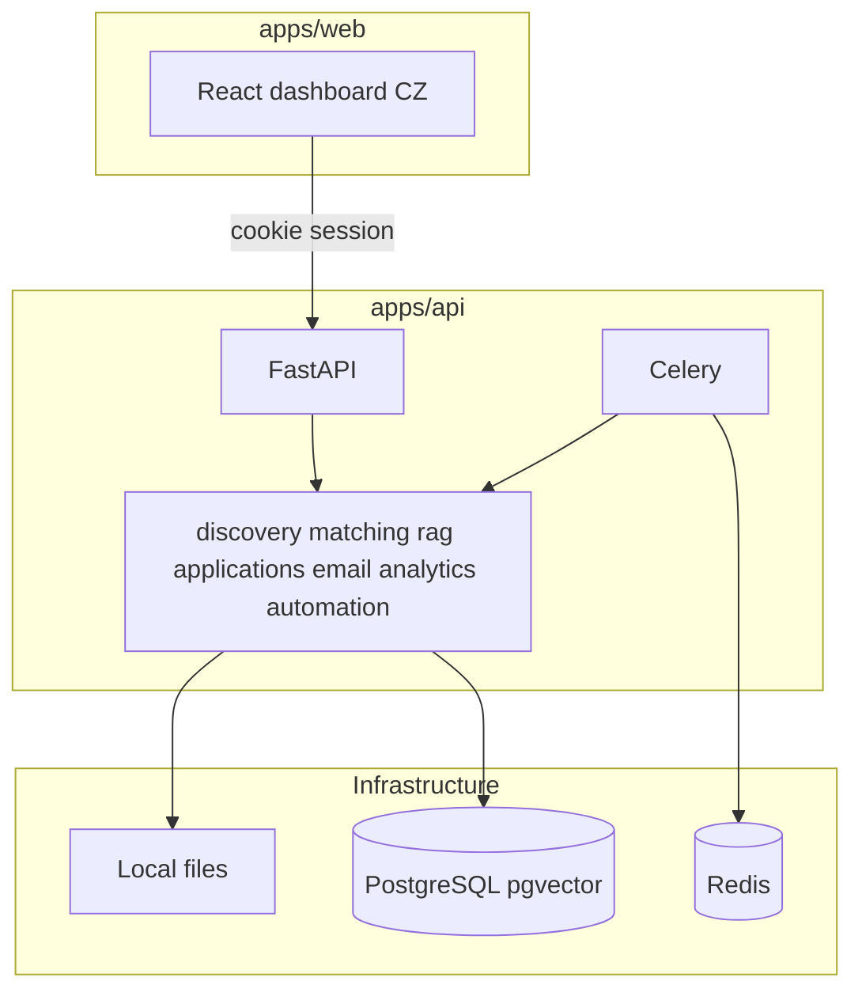

# Architecture

ApplyMind is a modular monolith: FastAPI HTTP API, Celery workers, React SPA, PostgreSQL (+ pgvector), Redis.

## Modules

| Module | Responsibility |
|--------|----------------|
| discovery | ATS adapters, RSS, manual import, source health |
| matching | Explainable weighted scoring + hard exclusions |
| rag | Ingestion, embeddings, hybrid retrieval, citations |
| applications | Draft generation, state machine, ApplyRouter, submit |
| email | IMAP/SMTP Email.cz, classification, sync |
| analytics | KPIs and funnel from live tables |
| automation | Celery schedules and manual runs |

## Design constraints

- Single-user (no multi-tenant)
- Human approval for outbound high-impact actions
- Untrusted external content never overrides system prompts
- Czech portals without verified public candidate APIs are marked UNSUPPORTED
